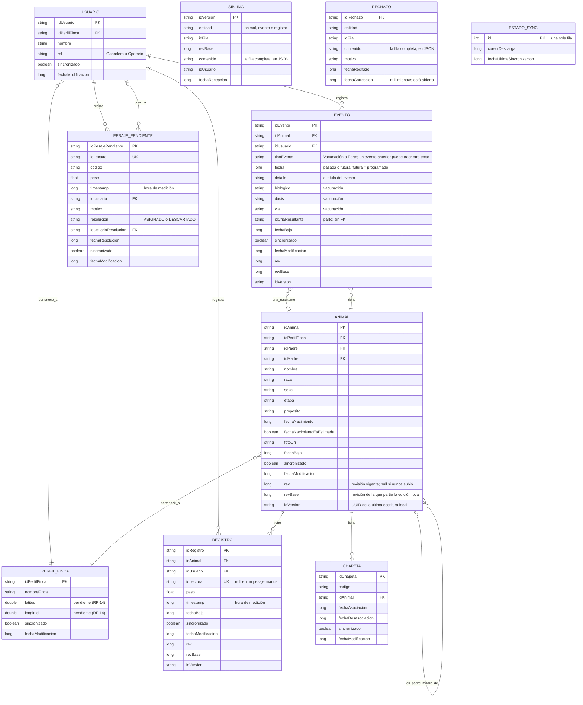

# Diagrama de relaciones — Sistema de trazabilidad bovina

Esquema Room de la app: lo que hay hoy en `main` más lo ya decidido (revisiones y sincronización, ADR-0004 y ADR-0005). Lo marcado **pendiente** todavía no está en `main`.

## Notas

- `ANIMAL.idPadre` / `ANIMAL.idMadre`: FK autorreferencial, `onDelete = SET_NULL`.
- `ANIMAL.fechaBaja`, `EVENTO.fechaBaja`, `REGISTRO.fechaBaja`: baja lógica (nunca se borra), por exigencia de trazabilidad de la Ley 1659. `CHAPETA.fechaDesasociacion` hace lo mismo para la Chapeta: está activa mientras es nula, y un mismo `codigo` tiene como máximo una Chapeta activa (índice único parcial).
- `REGISTRO.idLectura` y `PESAJE_PENDIENTE.idLectura` son únicos: un pesaje del ESP32 se guarda una sola vez (ADR-0003). En `PESAJE_PENDIENTE`, `resolucion`, `idUsuarioResolucion` y `fechaResolucion` son nulas mientras está sin resolver y se llenan juntas al conciliar.
- `PERFIL_FINCA` no lleva FK hacia `USUARIO`: la dirección es `USUARIO → PERFIL_FINCA` y `ANIMAL → PERFIL_FINCA`.
- `EVENTO` lleva los campos de su tipo en la misma fila (#128): `biologico`, `dosis` y `via` en una vacunación, `idCriaResultante` en un parto, nulos en los demás. Así viajan con su `rev`. `idCriaResultante` no es una FK, porque el evento puede subir antes que su cría; al registrar un parto con cría, la cría queda con el animal del evento como madre o padre. Un evento con `fecha` posterior a ahora está programado y no cuenta en los indicadores hasta que esa fecha llega.

### Revisiones y sincronización (ADR-0004, ADR-0005)

- Solo `ANIMAL`, `EVENTO` y `REGISTRO` llevan `rev`, `revBase` e `idVersion`. Toda escritura local genera un `idVersion` nuevo; varias escrituras antes de subir conservan el `revBase` de la primera. `CHAPETA` y `PESAJE_PENDIENTE` se insertan y cambian de estado una sola vez; `PERFIL_FINCA` tiene un único escritor y `USUARIO` solo lo cambia el servidor, así que ninguna lleva revisión.
- `SIBLING` guarda las ediciones en conflicto sin resolver de cualquier fila con revisiones. Es polimórfica (`entidad` + `idFila`), así que no tiene FK. Al resolverse sale de la tabla local; el servidor la conserva.
- `RECHAZO` guarda la fila que el servidor no aceptó, completa y con su motivo, después de sacarla de su tabla. Mientras `fechaCorreccion` es nula, la fila no se reenvía. También es polimórfica.
- `ESTADO_SYNC` guarda el último cursor de descarga aplicado y la fecha de la última sincronización completa.

## Solo en el servidor (Supabase)

El esquema del servidor replica las tablas de arriba, con estas diferencias. Su fuente de verdad son las migraciones SQL del repositorio.

| Diferencia | Para qué |
|---|---|
| Sin `sincronizado`, `revBase` ni `idVersion` en las filas | Son estado local de cada celular. |
| Columna `cursor` en cada tabla, tomada de una secuencia global en cada escritura | Descarga incremental (RF-36). |
| Tabla `revision` (entidad, fila, `rev`, `id_version`, contenido, usuario, fecha) | Historial completo de cada fila con revisiones, sin depuración (RN-16). |
| Tabla `sibling`, con `resuelto_por` (el `id_version` de la resolución) y su fecha | Los siblings se conservan después de resolverse. |
| Tabla `invitacion` (código, finca, creada por, vence, usada por) | Código de un solo uso que vence a los 7 días (RN-18). |
| Tabla `aceptacion_datos` (usuario, versión del texto, fecha) | Autorización de la Ley 1581 (RNF-13). |
